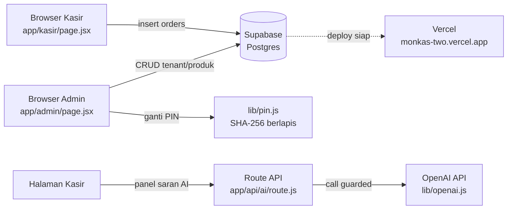
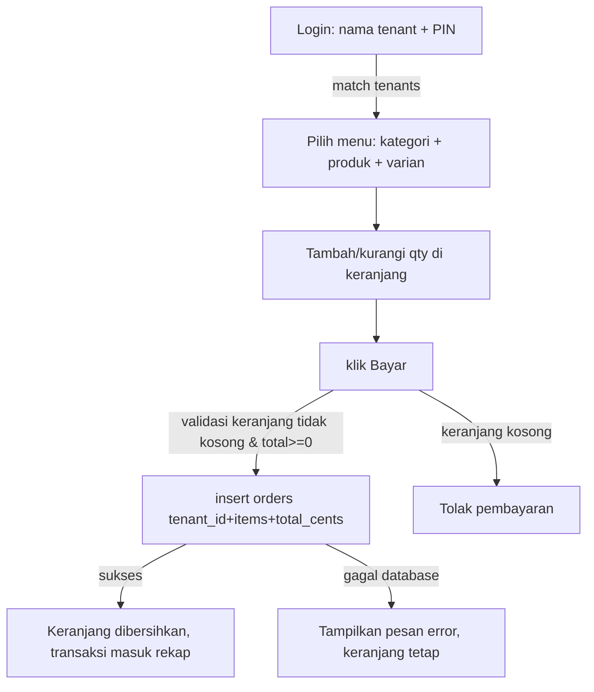
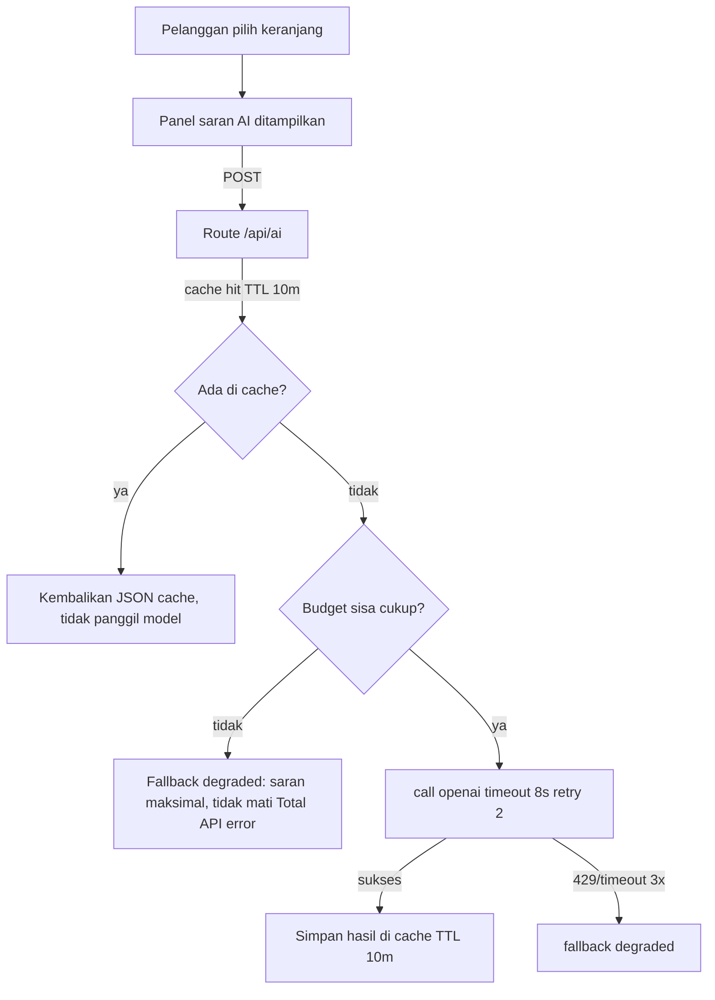

# BLUEPRINT MONKAS — Kasir Multi-Tenant Satu QRIS

> Dokumen acuan arsitektur dan standar pengembangan MONKAS. Sumber kebenaran: repo `ArjunaSinaga/monkas`, deploy `monkas-two.vercel.app`, database Supabase `kfpfgmbuansfggxdqitd`. Update terakhir: 22 Oktober 2026, diperbarui terhadap kondisi nyata commit `87dd0ab` di `origin/main` (tip yang di-deploy Vercel) plus verifikasi HTTP live di bagian 11.

---

## 1. Ringkasan Produk

MONKAS adalah aplikasi kasir (Point of Sales) multi-tenant berbasis web untuk lapak/kantin yang berbagi satu tempat fisik dan satu papan QRIS bersama. Aplikasi memisahkan tiga dunia:

1. **Tenant (pedagang)** — log in dengan nama tenant + PIN, mencatat pesanan di halaman kasir, proses selesai setelah pembayaran masuk ke satu papan QRIS bersama (validasi pembayaran masih manual oleh pedagang).
2. **Admin (pengelola lapak)** — log in dengan username + PIN 6 digit, mengelola daftar tenant, QRIS, produk dan varian, laporan omzet, tutup hari, serta status aktif tenant. Ada lockout setelah 5x gagal login.

3. **Pembeli (opsional/demo)** — halaman `/demo` untuk visualisasi tanpa akses data operasional.

Prinsip desain: satu QRIS untuk semua tenant, `paid_at` langsung tercatat saat transaksi disimpan, rekap omzet per tenant dan tutup hari dihitung dari tabel `orders` tanpa integrasi bank (belum terverifikasi status rekon kuitansi fisik; hanya validasi manual).

---

## 2. Arsitektur Sistem



Komposisi teknologi:

| Komponen | Teknologi | Catatan |
|---|---|---|
| Frontend + Routing | Next.js App Router (versi baru, baca `node_modules/next/dist/docs/` sebelum koding) | Semua halaman static-friendly |
| Bahasa | JavaScript + JSX (bukan TypeScript) | `lib/supabase.js` titik masuk `db` client |
| Database | Supabase `kfpfgmbuansfggxdqitd` | Migrations di `supabase/migrations/*.sql`, idempoten |
| Auth | Kredensial lokal, bukan Supabase Auth | admins = `username` + PIN 6 digit (hash SHA-256 berlapis); tenants = nama + PIN (hash sama). Login pakai satu form yang otomatis mendeteksi admin/tenant; lockout setelah 5x gagal |
| API AI | OpenAI API via `lib/openai.js` | Guard biaya: cache TTL 10 menit, dedupe, limit 60 call/jam, budget $1/proses, timeout 8 detik, retry 2, fallback degraded, akuntansi USD |
| Deploy | Vercel otomatis dari push `main` | Tier 2 (wajib konfirmasi user sebelum deploy produksi) |

---

## 3. Model Data

### 3.1 Tabel dan Relasi

```mermaid
erDiagram
  tenants ||--o{ products : "punya"
  products ||--o{ variants : "punya"
  tenants ||--o{ orders : "minta"
  tenants ||--o|| admins : "diawasi"
```

### 3.2 Skema Lengkap

| Tabel | Kolom | Tipe | Arti |
|---|---|---|---|
| `tenants` | id | uuid PK default `gen_random_uuid()` | Identitas tenant |
| | name | text not null | Nama pedagang, dipakai login tenant |
| | qris_photo_url | text nullable | URL file QRIS tenant |
| | pin_hash | text not null | Hash PIN tenant |
| | is_active | boolean not null default true | Soft delete flag (migration 004) |
| | deleted_at | timestamptz nullable | Waktu dinonaktifkan |
| | created_at | timestamptz default now() | Waktu dibuat |
| `products` | id | uuid PK | Identitas produk |
| | tenant_id | uuid not null FK → tenants | Pemilik produk |
| | name | text not null | Nama menu |
| | price_cents | integer not null, check >= 0 | Harga dalam sen (rupiah × 100) |
| | category | text not null default 'Minuman' | Kategori `Minuman\|Makanan` (migration 003) |
| | is_active | boolean default true | Produk aktif/ditutup |
| | created_at | timestamptz default now() | Waktu dibuat |
| `variants` | id | uuid PK | Varian ukuran/suhu/dll |
| | product_id | uuid not null FK → products | Induk varian |
| | name | text not null | Nama varian, mis. "Reguler" |
| | price_delta_cents | integer not null default 0 | Selisih harga vs nilai `price_cents` produk |
| | created_at | timestamptz default now() | Waktu dibuat |
| `orders` | id | uuid PK | Transaksi |
| | tenant_id | uuid not null FK → tenants | Tenant pemilik transaksi |
| | items | jsonb not null | Daftar item {product_id, variant_id, name, qty, unit_cents} |
| | total_cents | integer not null check >= 0 | Nilai transaksi dalam sen |
| | paid_at | timestamptz default now() | Waktu dibayar, dipakai rekap tutup hari |
| | voided | boolean default false | Flag pembatalan (dipakai laporan) |
| `admins` | id | uuid PK | Identitas admin |
| | username | text unique not null | Username login admin |
| | password_hash | text not null | Hash password SHA-256 berlapis |
| | created_at | timestamptz default now() | Waktu dibuat |

### 3.3 Index

| Index | Kolom | Alasan |
|---|---|---|
| `idx_products_tenant` | products(tenant_id) | Filter produk per tenant |
| `idx_variants_product` | variants(product_id) | Ambil varian per produk |
| `idx_orders_tenant` | orders(tenant_id) | Rekap omzet per tenant |
| `idx_products_tenant_category` | products(tenant_id, category) | Filter kategori halaman kasir |
| `idx_tenants_active` | tenants(is_active) | Daftar tenant aktif |

### 3.4 Migrations

Semua file di `supabase/migrations/*.sql` bersifat idempoten (aman dijalankan berkali-kali):

| File | Fokus |
|---|---|
| `001_core.sql` | 4 tabel inti + index |
| `002_admins.sql` | Tabel admin |
| `003_products_category.sql` | Kolom `category` + index composite |
| `004_tenant_soft_delete.sql` | Kolom `is_active` + `deleted_at`, nonaktifkan bukan hapus permanen (alasan: riwayat orders tidak boleh hilang) |

---

## 4. Alur Kerja

### 4.1 Alur Kasir (Tenant)



Catatan implementasi: halaman kasir satu file JSX dengan ukuran ratusan baris; seluruh state disimpan lokal via `useState`, tanpa state global.

### 4.2 Alur Admin

```mermaid
flowchart TD
  LI[Login 1 form: username + PIN] -->{deteksi otomatis}
  BR[Admin / Tenant] --> BL[Sistem desain: grid kotak + popup bottom sheet]
  BL --> T[Kelola tenant: buat + set QRIS opsional + soft delete + pulihkan]
  BL --> PG[Kelola produk dan varian: CRUD + form edit + kategori Minuman-Makanan]
  BL --> G[Ganti PIN admin: policy PIN 6 digit]
  BL --> RP[Laporan omzet per tenant dihitung client-side dari orders, limit 500 baris terbaru]
  BL --> TH[Tutup hari: rekam order hari ini yang tidak voided]
  T -->|nonaktif: ketik ulang nama tenant + PIN admin, 3 lapis| SD[is_active=false + deleted_at terisi]
  T -->|pulihkan| RST[is_active=true + deleted_at=null]
```

Konfirmasi nonaktif 3 lapis: klik → modal → ketik ulang nama tenant → ketik ulang PIN admin. Didukung oleh migration 004.

### 4.3 Alur AI Panel (Di Halaman Kasir)



Guard biaya diberlakukan dengan **cache TTL 10 menit + dedupe + limit 60/jam + hardcap $1/permintaan + timeout 8 detik + retry 2x + fallback degraded** — disorot pada 20 Okt 2026.

---

## 5. Peran, Kewenangan, dan Batasan

| Peran | Kewenangan | Batasan | Contoh Skenario |
|---|---|---|---|
| Admin lapak | Membuat/menonaktifkan/memulihkan tenant, set QRIS, kelola produk dan varian, ganti PIN admin, lihat laporan, tutup hari | Tidak bisa menginput order untuk tenant; tidak bisa melihat riwayat order lebih dari 500 baris terbaru | Admin menonaktifkan tenant yang tidak aktif lewat konfirmasi 3 lapis (nama tenant + PIN admin) |
| Tenant (kasir) | Login sendiri, ambil produk miliknya, masukkan keranjang, insert order, lihat panel saran AI | Tidak bisa akses data tenant lain (domain sebenarnya baca semuanya karena anon key Supabase; belum ada RLS), tidak bisa hapus order | Kasir lapak makanan pakai PIN 4 digit untuk login |
| Pelanggan akhir | Fisik: keduanya. Teknis: keduanya terlibat. | tidak ada | Dua catatan minimal pertama per tenant dari arus kasir—belum terintegrasi dalam blueprint |

---

## 6. Standar UI/UX

| Dimensi | Standar |
|---|---|
| Presisi | Spacing, tipografi, warna, ukuran exact (token di `app/globals.css`, class `.btn/.card/.price`) |
| Layout kasir | 1 kolom di mobile, bukan desktop dikecilkan |
| Target sentuh | Minimal 44px untuk tombol primer, minimal 24px untuk tombol sekunder |
| Interaksi | Hover, transisi, state lengkap (loading/empty/error/disabled) |
| Anti-slop | Tanpa dashboard generik, tanpa gradien berlebihan, tanpa glassmorphism tanpa fungsi |
| Aset | Foto/ikon legal komersial atau generate sendiri |

---

## 7. Keamanan dan Status Risiko

| Item | Status | Rincian |
|---|---|---|
| Login admin | PASS | PIN 6 digit, hash SHA-256 berlapis, policy password, lockout 5x gagal login (commit `8c088e3`, `2ced737`) |
| Login tenant PIN | PASS | SATU form login auto-deteksi admin/tenant, nama tenant unik (commit `5166992`) |
| Soft delete tenant | PASS | Konfirmasi 3 lapis (ketik ulang nama tenant + PIN admin) + fitur pulihkan, commit `87dd0ab` |
| Guard biaya AI | PASS | Budget + limit + timeout + fallback |
| Sistem desain + a11y | PASS | Design token, popup bottom sheet, target sentuh 32/44px, audit responsif otomatis (commit `5e14dd7`, `902b07b`, `c3a8ffa`) |
| **RLS Supabase** | **BELUM DIUJI** | 4 tabel core + admins kemungkinan tanpa row-level security, anon key bisa read/write. Perlu audit di fase berikut. |
| **Live call OpenAI** | **BELUM TERVERIFIKASI** | `OPENAI_API_KEY` belum diuji di env produksi; hanya diuji lewat `scripts/mock-openai.mjs` |
| Idempoten tutup hari | **BELUM ADA** | belum ada guard DB agar tutup hari tidak terjadi dua kali |
| Double-submit order | **BELUM ADA** | insert orders belum punya unique/idempotency guard |

---

## 8. Roadmap

### Fase 1 — Kebenaran Data (0 biaya)
1. Audit RLS: tambah policy minimal (anon read-only produk + tenant aktif; orders tulis bebas untuk kasir, untuk rekap per admin).
2. Verifikasi live call OpenAI: pasang `OPENAI_API_KEY` di Vercel + lokal, jalankan 1 permintaan, cek akuntansi USD.

### Fase 2 — Hardening Kasir
1. Migration `005_idempotent_orders.sql`: tambah guard agar satu keranjang tidak double-submit (kolom `session_key` atau unique constraint).
2. Laporan admin saat ini dihitung client-side dari `orders` dengan `limit(500)`: pindahkan ke query agregat (API route atau view SQL `group by tenant_id`) agar rekap tidak terpotong saat order sudah banyak.
3. Uji alur kasir di Playwright: pilih produk, bayar, cek rekap, di viewport 375px.

### Fase 3 — Fitur Perluasan (opsional, perlu persetujuan)
1. Integrasi booking janji-temu, draft di `docs/FEATURE-BOOKING-JANJI-TEMU.md` (belum disetujui sebagai scope).
2. QRIS scanner atau checkout via scan.

---

## 9. Bagian Belum Terverifikasi

1. **RLS di atas 5 tabel belum diuji secara nyata**, scan migration menunjukkan `CREATE TABLE` dan `CREATE INDEX` saja, tidak melihat `enable row level security` atau policy.
2. **Live call OpenAI belum terverifikasi di produksi**: struktur guard ada, hanya diuji dengan mock. Status env `OPENAI_API_KEY` di Vercel belum dicek.
3. **Status apply migration di project Supabase live belum diverifikasi**: README menyatakan validasi 003 hanya di PostgreSQL lokal 18.4, bukan project live. Untuk 004 (soft delete) statusnya juga belum terverifikasi.
4. **Rekap laporan memotong data**: query client-side menggunakan `limit(500)`, akurasi laporan di atas 500 order per halaman load belum diukur.
5. **Integrasi pembayaran belum ada**: `paid_at` menggunakan waktu insert (timestamp), bukan konfirmasi dari perbankan atau scan QRIS. Cocok dengan rencana awal (validasi manual), tapi harus jelas di pemahaman user.

---

## 10. Aturan Kontribusi

1. Baca `node_modules/next/dist/docs/` sebelum menulis kode Next.js ( dokumen versi terbaru, breaking changes banyak).
2. Migration SQL harus idempoten (menggunakan `if not exists`).
3. Tulis ke dalam sen (`_cents`), bukan rupiah langsung, di seluruh sistem.
4. Hapus unused imports, orphan code, dan efek samping di luar scope.
5. `npm run build` + `npx eslint app/*` + gate `bin\verify-task.ps1` harus hijau sebelum push ke `main`.
6. Deploy produksi (Tier 2) hanya setelah konfirmasi eksplisit user.

---

## 11. Status Deployment Terverifikasi (22 Oktober 2026)

Verifikasi nyata dengan HTTP request ke produksi Vercel:

| Route | HTTP Status | Arti |
|---|---|---|
| `https://monkas-two.vercel.app/` | 200 | Landing / login hidup |
| `https://monkas-two.vercel.app/kasir` | 200 | Halaman kasir hidup |
| `https://monkas-two.vercel.app/admin` | 200 | Halaman admin hidup |
| `https://monkas-two.vercel.app/demo` | 200 | Demo POS dengan data seed hidup |

| Repo | Commit yang di-deploy Vercel |
|---|---|
| `ArjunaSinaga/monkas` | `87dd0ab` (tip `origin/main`) |

Fitur yang pasti ada di kode ter-deploy (dibaca langsung dari kode, bukan asumsi): satu form login otomatis-detect admin/tenant, PIN admin 6 digit + lockout, kelola produk/varian + kategori, soft delete tenant konfirmasi 3 lapis, grid popup dengan sistem desain token, laporan client-side, tutup hari, panel saran AI dengan guard biaya, halaman `/demo` tanpa ketergantungan Supabase.

---

**Penanda versi ini:** Blueprint disusun dari hasil read langsung kode + migrations di `C:\tes2\monkas` + verifikasi HTTP ke produksi Vercel, bukan dari asumsi atau ekspektasi produk.
