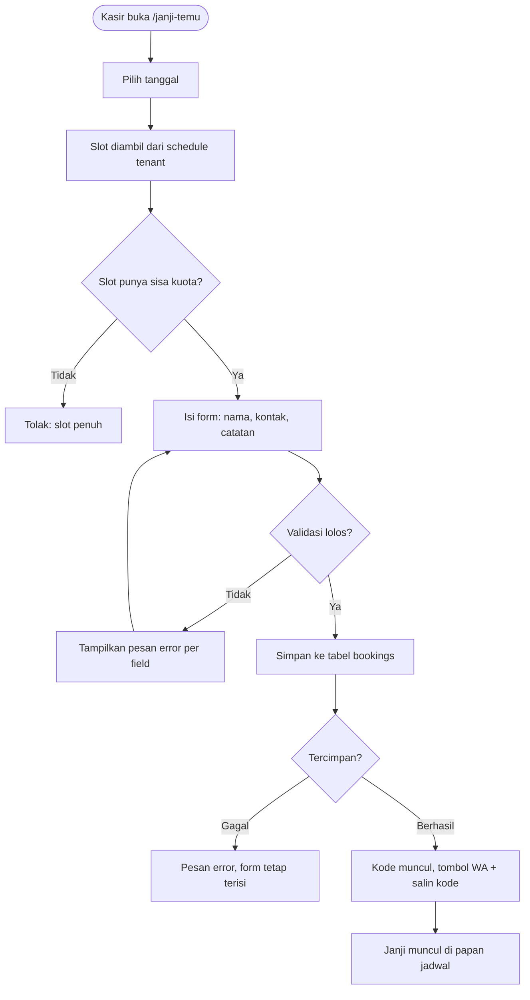
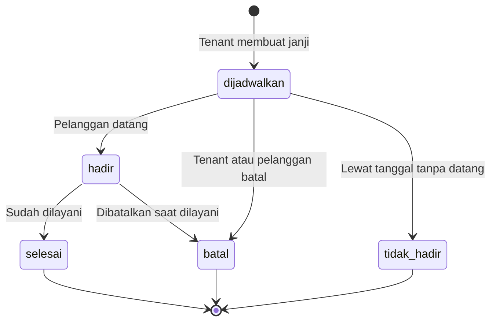
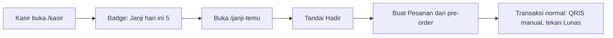

# MONKAS - Fitur "Booking Janji Temu" - Requirement & Plan

| Item | Nilai |
|---|---|
| Status | DRAFT untuk persetujuan user (belum ada kode ditulis) |
| Tanggal | 2026-10-20 |
| Baseline | repo `monkas` commit `2ced737` (live di Vercel) + DB Supabase project monkas |
| Tabel DB sekarang | `admins`, `tenants`, `products`, `variants`, `orders` |
| Route app sekarang | `/` (login), `/kasir`, `/admin`, `/demo`, `/api/ai` |
| Target rilis | dopo user menyetujui plan ini |

---

## 1. Ringkasan Eksekutif

Fitur "Booking Janji Temu" menambah satu kapabilitas baru ke MONKAS: tenant bisa mencatat janji temu pelanggan (tanggal + jam + nama + kontak), melihat papan jadwal hari itu, menandai pelanggan hadir, membatalkan, dan mengubah janji temu menjadi pesanan (pre-order) di kasir.

Fungsi ini berdiri sendiri, tidak mengubah alur kasir yang sudah jalan. Pelanggan yang tidak punya janji temu tetap dilayani seperti biasa.

Nilai bisnisnya: tenant tahu sejak pagi berapa pelanggan yang akan datang dan jam berapa, sehingga stok, tenaga kerja, dan urutan antrean bisa diatur, dan pelanggan tidak perlu menunggu lama di tempat.

---

## 2. Asumsi Yang Dipakai (Sesi Non-Interaktif, Tidak Bisa Tanya)

Saya tidak bisa membuka sesi tanya-jawab di run ini, jadi saya ambil interpretasi paling minim dan menandainya. Semua bisa dikoreksi sebelum eksekusi.

| # | Asumsi | Alasan | Dampak Kalau Salah |
|---|---|---|---|
| A1 | Janji temu dicatat staff tenant (kasir), bukan pelanggan self-service | MONKAS belum punya halaman publik; model pesan di blueprint tetap kasir-input | Link publik harus jadi task baru (T7) |
| A2 | Isi minimal: tanggal + jam slot + nama pelanggan + no HP + catatan | Cukup untuk manage antrean, tidak bergantung ke produk atau order | Pre-order jadi tahap 2 |
| A3 | Jam operasional dan durasi slot diatur per tenant | Tiap tenant punya jam buka sendiri | Konfigurasi global bisa jadi alternatif |
| A4 | Pelanggan tidak punya akun dan tidak login | Sesuai blueprint (tidak ada daftar mandiri) | - |
| A5 | Konfirmasi pelanggan lewat tombol "Hubungi via WhatsApp" (tautan manual) | Tanpa biaya API, tanpa backend tambahan | Integrasi WA API = task terpisah |
| A6 | Janji temu tidak masuk rekap penjualan | Rekap uang hanya dari `orders` | Rekap janji temu = task tambahan |
| A7 | Satu device = satu tenant, session lokal seperti app sekarang | Konsisten dengan implementasi sekarang | - |
| A8 | Tanggal dan jam disimpan sebagai waktu lokal WIB | Semua tenant di satu zona waktu | - |

---

## 3. Baseline: Apa Yang Sudah Ada dan Apa Yang Belum

| Bagian | Status | Catatan |
|---|---|---|
| Login admin + tenant | Sudah | `app/page.jsx`, session di `localStorage` (`monkas_session` / `monkas_admin`) |
| Panel admin (tenant, produk, QRIS) | Sudah | `app/admin/page.jsx` |
| Kasir (produk, varian, keranjang, bayar) | Sudah | `app/kasir/page.jsx`, insert ke `orders` |
| Rekap, tutup hari, void ber-PIN | Belum | Masih Task 4-6 di blueprint |
| RLS tenant-scoped | Belum | Policy sekarang `tmp_anon_*` dengan `qual = true` (lihat Risiko R1) |
| Halaman publik pelanggan | Tidak ada | Sengaja, sesuai blueprint |

Konsekuensi: fitur janji temu **tidak** butuh modul yang belum ada, kecuali bagian "ubah janji temu jadi pesanan" yang memakai alur kasir yang sudah ada.

---

## 4. Requirement Fungsional

### 4.1 Peran dan kewenangan

| Peran | Kewenangan pada janji temu | Batasan |
|---|---|---|
| Admin / manager | Lihat semua janji temu semua tenant, filter per tenant dan per tanggal, membatalkan janji yang bermasalah | Tidak bisa membuat janji temu milik tenant lain |
| Tenant (kasir) | Buat, ubah, batalkan, tandai hadir, ubah jadi pesanan - hanya data tenant-nya sendiri | Tidak bisa melihat janji temu tenant lain |
| Pelanggan | Tidak punya akses ke aplikasi | Konfirmasi lewat WhatsApp manual dari kasir |

### 4.2 Daftar requirement

| ID | Requirement | Prioritas |
|---|---|---|
| FR-01 | Tenant membuat janji temu baru: tanggal, slot jam, nama pelanggan, no HP opsional, catatan opsional | Wajib |
| FR-02 | Slot jam dihitung dari jam operasional tenant (buka, tutup, durasi slot, kuota per slot) | Wajib |
| FR-03 | Sistem menolak pembuatan janji temu bila slot penuh atau di luar jam operasional | Wajib |
| FR-04 | Setiap janji temu punya kode unik pendek untuk dipakai pelanggan saat konfirmasi | Wajib |
| FR-05 | Tenant melihat papan jadwal janji temu per tanggal (default hari ini) | Wajib |
| FR-06 | Tenant menandai pelanggan hadir, selesai, tidak hadir, atau membatalkan | Wajib |
| FR-07 | Tenant mengubah jadwal janji temu (pindah tanggal/jam) bila masih valid | Wajib |
| FR-08 | Tombol "Hubungi via WhatsApp" membuka chat ke nomor pelanggan dengan pesan siap kirim | Wajib |
| FR-09 | Tombol "Buat Pesanan" mengisi keranjang kasir dari pre-order yang tersimpan | Tahap 2 (butuh `items`) |
| FR-10 | Admin melihat rekap janji temu per tenant dan per tanggal | Wajib |
| FR-11 | Janji temu yang tanggalnya sudah lewat otomatis berstatus "tidak hadir" pada tampilan | Wajib |
| FR-12 | Janji temu tidak memengaruhi rekap penjualan dan tidak terkunci oleh Tutup Hari | Wajib |

### 4.3 Aturan status

| Status | Makna | Bisa jadi | Sifat |
|---|---|---|---|
| `dijadwalkan` | Janji dibuat, pelanggan belum datang | `hadir`, `batal`, `tidak_hadir`, `selesai` | Aktif (menghitung kuota slot) |
| `hadir` | Pelanggan sudah datang, sedang dilayani | `selesai`, `batal` | Aktif |
| `selesai` | Sudah dilayani selesai | - | Terminal |
| `batal` | Dibatalkan tenant atau pelanggan | - | Terminal, tidak mengitung kuota |
| `tidak_hadir` | Pelanggan tidak datang | - | Terminal, tidak mengitung kuota |

---

## 5. Requirement Non-Fungsional

| ID | Requirement | Cara ukur |
|---|---|---|
| NFR-01 | Halaman papan janji temu tampil di bawah 1 detik untuk 50 janji dalam 1 tenant | Ukur manual di perangkat |
| NFR-02 | Data janji temu terisolasi per tenant | Query tenant B tidak pernah mengembalikan baris tenant A |
| NFR-03 | Tidak ada data pelanggan yang bocor lewat API publik | Audit policy RLS + tidak ada route publik |
| NFR-04 | Tidak ada biaya API berjalan | Tidak pakai WA API, tidak pakai SMS gateway |
| NFR-05 | Form tidak kehilangan input saat gagal simpan | Uji dengan jaringan dimatikan |
| NFR-06 | Tanggal, jam, dan kode selalu tampil dalam bahasa Indonesia, zona WIB | Uji manual |
| NFR-07 | Tetap jalan di tablet Android (PWA) seperti kasir sekarang | Uji perangkat |

---

## 6. User Story dan Acceptance Criteria

Format: Given (Given / When / Then).

| ID | User story | Acceptance criteria |
|---|---|---|
| US-01 | Sebagai kasir, saya ingin mencatat janji temu pelanggan yang telepon, supaya tahu siapa akan datang | Given saya sudah login sebagai tenant, When saya isi nama "Budi", tanggal besok, slot 10:00, no HP 0812..., Then tersimpan 1 baris dengan kode unik dan status `dijadwalkan`, dan muncul di papan jadwal besok |
| US-02 | Sebagai kasir, saya tidak mau menerima janji lebih banyak dari kapasitas | Given kuota 1 per slot, When slot 10:00 sudah ada 1 janji, Then form menolak dengan pesan "Slot 10:00 penuh" dan tidak ada baris baru |
| US-03 | Sebagai kasir, saya ingin menandai pelanggan hadir | Given ada janji `dijadwalkan`, When saya tekan "Tandai Hadir", Then status jadi `hadir` dan muncul di daftar antrean hari ini |
| US-04 | Sebagai pelanggan, saya ingin konfirmasi janji temu | Given janji sudah ada, When kasir tekan "Hubungi via WA", Then WhatsApp terbuka ke nomor pelanggan dengan pesan berisi kode, tanggal, jam, dan nama tenant |
| US-05 | Sebagai kasir, saya ingin membatalkan janji | Given ada janji `dijadwalkan`, When saya tekan "Batalkan" dan isi alasan, Then status jadi `batal`, slot terlepas, dan alasan tersimpan |
| US-06 | Sebagai admin, saya ingin tahu jumlah janji temu semua tenant | Given 3 tenant punya janji besok, When saya buka bagian Janji Temu di admin, Then muncul 3 baris rekap per tenant dengan jumlah dan rata-rata jam |
| US-07 | Sebagai kasir, saya ingin pelanggan tanpa janji tetap bisa dilayani | Given pelanggan datang tanpa janji, When saya transaksi normal di kasir, Then tidak ada perubahan pada alur kasir |
| US-08 | Sebagai kasir, saya tidak bisa melihat janji tenant lain | Given saya login sebagai tenant A, When saya mencoba membuka data tenant B lewat URL atau request, Then data tenant B tidak pernah tampil |

---

## 7. Model Data

### 7.1 Tabel baru: `bookings`

Kolom berikut adalah rancangan, belum dieksekusi ke database.

| Kolom | Tipe | Aturan |
|---|---|---|
| `id` | uuid | primary key, default `gen_random_uuid()` |
| `tenant_id` | uuid | wajib, referensi `tenants(id)` cascade |
| `kode` | text | wajib, unik per tenant, 4 karakter tanpa huruf/angka ambigu |
| `nama_pelanggan` | text | wajib, 1-80 karakter |
| `kontak` | text | opsional, nomor HP untuk WhatsApp |
| `tanggal` | date | wajib, hari janji temu |
| `jam_mulai` | time | wajib, mulai slot |
| `jam_selesai` | time | wajib, akhir slot |
| `status` | text | default `dijadwalkan`, check 5 nilai status |
| `catatan` | text | opsional, bebas |
| `items` | jsonb | opsional, pre-order (tahap 2) |
| `order_id` | uuid | opsional, terisi saat janji temu diubah jadi pesanan |
| `dibuat_oleh` | text | `tenant` atau `admin` |
| `created_at` | timestamptz | default `now()` |
| `updated_at` | timestamptz | default `now()` |

Index yang perlu: unik `(tenant_id, kode)`, `(tenant_id, tanggal, jam_mulai)` untuk papan harian, `(tenant_id, status)` untuk rekap.

### 7.2 Perubahan tabel `tenants`

Satu kolom baru `schedule jsonb` berisi: `open`, `close`, `slot_minutes`, `max_per_slot`, `days` (daftar hari aktif, 0 = Minggu). Default: buka 09:00, tutup 21:00, slot 60 menit, kuota 1, semua hari aktif.

Alasan pakai satu kolom jsonb, bukan tabel terpisah: kebutuhan saat ini hanya "satu aturan per tenant". Kalau nanti butuh aturan per hari (buka 08:00 hari Senin, tutup 18:00 Jumat), barulah dipecah ke tabel `tenant_schedules`.

### 7.3 Randomisasi kode

Alfabet: `ABCDEFGHJKLMNPQRSTUVWXYZ23456789` (tanpa I, O, 0, 1). Panjang 4. Bentrok diperbaiki dengan generate ulang sampai unik per tenant.

### 7.4 Isolasi data (RLS)

| Opsi | Isi | Konsekuensi |
|---|---|---|
| R1 (pola app sekarang) | Policy `tmp_anon_bookings` untuk role `anon` dengan `ALL true` | Konsisten dan cepat, tapi anon key bisa membaca semua janji temu semua tenant, termasuk nama dan nomor HP. Tidak boleh dipakai untuk produksi |
| R2 (rekomendasi) | Tidak ada policy untuk `anon`, akses lewat Edge Function dengan service role yang memvalidasi sesi | Data pelanggan aman, tapi butuh task tersendiri (T0) |

Keputusan: pakai R1 untuk tahap demo, T0 wajib dikerjakan sebelum dipakai tenant sungguhan.

---

## 8. Alur Utama

### 8.1 Alur buat janji temu

### 8.2 Alur status janji temu

### 8.3 Alur harian di kasir

---

## 9. Spesifikasi Layar

Route baru: `/janji-temu` (butuh session tenant, sama seperti `/kasir`). Route admin: bagian baru di `/admin`.

### 9.1 Papan jadwal (halaman utama)

| Area | Isi | Aturan |
|---|---|---|
| Header kiri | Nama tenant + tanggal terpilih | Selalu terlihat |
| Header kanan | Tombol "Catat Janji Temu", tombol "Keluar" | Sama seperti pola header kasir |
| Baris filter | Date picker (default hari ini), filter status | Tombol "Hari ini" untuk aksi satu tap |
| Daftar | Satu kartu per janji: jam, nama, kontak, status, catatan | Urut jam naik, status `dijadwalkan` dan `hadir` di atas |
| Aksi per kartu | "Tandai Hadir", "Hubungi via WA", "Buat Pesanan", "Batalkan", "Ubah" | "Buat Pesanan" hanya tampil bila `items` terisi |
| Footer kartu | Kode booking | Tombol salin kode |
| Panel atas | Ringkasan: total janji hari ini, jumlah hadir, jumlah batal | Angkaupdate otomatis |

### 9.2 Form catat janji temu (popup tengah)

| Field | Tipe | Validasi |
|---|---|---|
| Tanggal | Date picker | Wajib; tidak boleh di masa lalu; maksimal 30 hari ke depan |
| Slot | Grid chip jam | Wajib; slot penuh tidak bisa dipilih (chip disabled) |
| Nama pelanggan | Text | Wajib; 1-80 karakter |
| No HP / WhatsApp | Text opsional | Angka, spasi, `+`, `-` saja; maksimal 20 karakter |
| Catatan | Text area opsional | Maksimal 200 karakter |
| Tombol | "Simpan" dan "Batal" | Simpan nonaktif selama proses, untuk mencegah klik ganda |

### 9.3 Prinsip tampilan

Mengikuti pola visual app sekarang: kartu putih, border abu-abu, radius 12, aksen `#154c57`, teks `#2b2118` dan `#666`. Target perangkat tablet landscape. Tanpa gradient dekoratif, tanpa animasi berat.

---

## 10. Error dan Edge Case

| No | Situasi | Penanganan |
|---|---|---|
| E-01 | Slot penuh | Tolak simpan, pesan "Slot 10:00 sudah penuh (1/1)", tunjuk slot lain yang tersedia |
| E-02 | Tanggal di luar jam operasional | Tolak, pesan "Tenant buka 09:00 - 21:00" |
| E-03 | Tanggal lampau | Tolak, pesan "Tanggal tidak boleh di masa lalu" |
| E-04 | Nama kosong | Tolak di form, fokus ke field nama |
| E-05 | No HP tidak valid | Izinkan kosong; bila diisi dan bukan angka, pesan "Nomor tidak valid" |
| E-06 | Klik ganda tombol simpan | Tombol nonaktif saat proses, kode unik mencegah dobel baris |
| E-07 | Bentrok kode | Generate ulang kode otomatis |
| E-08 | Jaringan gagal saat simpan | Pesan "Gagal menyimpan. Coba lagi", form tetap terisi, tidak ada data hilang |
| E-09 | Tenant punya jadwal kosong | Fallback ke default 09:00-21:00 slot 60 menit, kuota 1 |
| E-10 | Janji lewat tanggal tanpa status diubah | Otomatis tampil sebagai "lewat" (baca `tidak_hadir`) tanpa menulis ke DB |
| E-11 | Pelanggan datang tanpa janji | Alur kasir normal, tidak ada perubahan |
| E-12 | Staff salah buka tenant lain | Session isolation: data tenant lain tidak pernah dimuat (dan T0 menutup celah RLS) |
| E-13 | Admin membatalkan janji tenant lain | Boleh, tercatat `dibuat_oleh = admin` |
| E-14 | Tutup Hari ditekan saat ada janji aktif | Janji tidak terpengaruh (bukan order); hanya order yang terkunci |
| E-15 | Pelanggan minta jadwal lain via WA | Di luar sistem, kasir ubah manual lewat tombol "Ubah" |

---

## 11. Integrasi dengan Modul Lain

| Modul | Pengaruh |
|---|---|
| Kasir (`/kasir`) | Badge jumlah janji hari ini di header; tombol "Buat Pesanan" mengisi keranjang dari `items` |
| Admin (`/admin`) | Section baru "Janji Temu": rekap per tenant, per tanggal |
| Tutup Hari | Tidak menyentuh janji temu (bedanya dengan `orders.pending`) |
| Rekap penjualan | Tidak berubah; uang tetap dari `orders` |
| AI (`/api/ai`) | Tidak dipakai di MVP |
| WhatsApp | Hanya tautan `wa.me`, tanpa API |

---

## 12. Plan Implementasi

Urutan dependency: T1 (data) harus dulu, T2 (helper) setelahnya, T3-T5 (UI) bisa jalan paralel setelah T2, T6 (verifikasi) terakhir. T0 berdiri sendiri sebagai prasyarat produksi.

### T0 - RLS earnest + service role (P1, prasyarat produksi)

| Langkah | Isi |
|---|---|
| 1 | Petakan akses per tabel: `admins` (hanya service role), `tenants`, `products`, `variants`, `orders`, `bookings` (tenant-scoped) |
| 2 | Buat Edge Function `monkas-api` dengan service role, validasi sesi tenant dari header |
| 3 | Hapus policy `tmp_anon_*` yang membolehkan anon pada semua tabel |
| 4 | Verifikasi: request tanpa sesi ditolak, tenant A tidak bisa baca tenant B |

Status: belum dikerjakan. Temuan yang jadi pemicu: policy sekarang memberi akses penuh ke `admins` (termasuk `password_hash`) bagi anon key.

### T1 - Migration 004 (data)

| Langkah | Isi |
|---|---|
| 1 | Tulis `supabase/migrations/004_bookings.sql`: tabel `bookings`, 3 index, kolom `tenants.schedule`, policy RLS untuk `bookings` |
| 2 | Terapkan ke DB Supabase project monkas lewat MCP `apply_migration` |
| 3 | Verifikasi: `list_tables` memuat `bookings`; insert 1 baris uji; select mengembalikan 1 baris; drop baris uji |

### T2 - `lib/booking.js` (helper)

| Langkah | Isi |
|---|---|
| 1 | `buildSlots(date, schedule)` - hitung daftar slot dan tandai yang penuh |
| 2 | `sisaKapasitas(slot, tenantId, date)` - hitung sisa kuota dari baris aktif |
| 3 | `buatKode()` - 4 karakter unik per tenant |
| 4 | `validasiBooking(input)` - daftar aturan validasi (E-02 sampai E-05) |
| 5 | `fetchJanjiTemu(tenantId, tanggal)`, `createBooking`, `updateStatus`, `updateJadwal` |
| 6 | Verifikasi: skrip node uji slot builder (termasuk hari buka-tutup, kuota, slot penuh) |

### T3 - Layar `/janji-temu` (tenant)

| Langkah | Isi |
|---|---|
| 1 | Papan jadwal per tanggal: daftar, ringkasan, filter status |
| 2 | Popup catat janji temu dengan date picker + grid slot |
| 3 | Aksi kartu: Tandai Hadir, Selesai, Batal (dengan alasan), Ubah jadwal |
| 4 | Tombol "Hubungi via WA" dan "Salin kode" |
| 5 | State kosong: "Belum ada janji temu tanggal ini" |
| 6 | Verifikasi: lint bersih, alur manual di browser, data benar di DB |

### T4 - Integrasi kasir

| Langkah | Isi |
|---|---|
| 1 | Badge "Janji hari ini" di header kasir |
| 2 | Tombol "Buat Pesanan" pada janji temu dengan `items` terisi: isi keranjang kasir, isi `order_id` setelah bayar |
| 3 | Verifikasi: pre-order jadi 1 order dengan `tenant_id` benar dan `order_id` terisi di booking |

### T5 - Rekap admin

| Langkah | Isi |
|---|---|
| 1 | Section "Janji Temu" di `/admin`: rekap per tenant untuk tanggal terpilih |
| 2 | Filter tanggal, jumlah per tenant, daftar detail saat diklik |
| 3 | Verifikasi: angka rekap cocok dengan jumlah baris di `bookings` |

### T6 - Verifikasi menyeluruh

| Langkah | Isi |
|---|---|
| 1 | `npm run lint` (script repo: `eslint app`) - exit 0 |
| 2 | `npm run build` - "Compiled successfully" |
| 3 | Jalankan `npm run dev`, lalu cek HTTP 200 untuk `/`, `/kasir`, `/admin`, `/janji-temu` |
| 4 | Uji skenario US-01 sampai US-08 di browser |
| 5 | Uji SQL: isolasi tenant, konflik kode, kuota slot, index terpakai |
| 6 | Gerbang workspace: `powershell -NoProfile -File C:\tes2\bin\verify-task.ps1` - exit 0 |
| 7 | Commit di repo monkas, push sesuai aturan repo (tanpa `.env`) |

### T7 - Fase 2 (opsional, belum dijadwalkan)

Link publik self-booking per tenant (butuh anti-spam dan aturan kuota), pre-order penuh, DP, dan pesan konfirmasi otomatis. Ini task terpisah, bukan bagian dari MVP.

---

## 13. Verifikasi (Ringkasan)

| Gate | Perintah | Lolos bila |
|---|---|---|
| Lint | `npm run lint` di `C:\tes2\monkas` | exit 0, tanpa error |
| Build | `npm run build` di `C:\tes2\monkas` | "Compiled successfully" |
| Runtime | `npm run dev` lalu request 4 route | semua HTTP 200 |
| Data | query SQL via MCP Supabase | baris benar, isolasi tenant jalan, kuota jalan |
| Gerbang workspace | `powershell -NoProfile -File C:\tes2\bin\verify-task.ps1` | exit 0 |
| Manual | US-01 sampai US-08 | semua sesuai criteria |

---

## 14. Risiko dan Mitigasi

| ID | Risiko | Dampak | Mitigasi |
|---|---|---|---|
| R-01 | Policy RLS sekarang memberi anon akses penuh ke semua tabel, termasuk `admins.password_hash` | Tinggi | T0 jadi prasyarat produksi; booking (data PII) tidak boleh memakai policy permanen |
| R-02 | Salah query membuat janji tenant A bocor ke tenant B | Tinggi | Filter `tenant_id` di semua query; uji US-08; RLS benar di T0 |
| R-03 | Scope melar ke self-booking publik | Sedang | T7 ditahan, MVP fokus staff-input |
| R-04 | Janji temu tidak dipakai kasir, jadi data kosong | Sedang | Papan hari ini di layar kasir (T4) supaya terlihat tanpa pindah halaman |
| R-05 | Pelanggan tetap datang tanpa booking | Rendah | Alur kasir tidak berubah, booking bersifat opsional |
| R-06 | Nomor HP salah ketik, WhatsApp tidak masuk | Rendah | Tombol WA memakai nomor yang diketik kasir; tampilkan nomor di kartu agar kasir bisa konfirmasi manual |
| R-07 | Set default jam buka-tutup tidak cocok tenant | Sedah | Nilai default di `tenants.schedule`, bisa diubah per tenant tanpa ubah kode |

---

## 15. Di Luar Scope MVP

Halaman publik pelanggan, pembayaran DP, integrasi WA API, reminder otomatis SMS/email, kalender bulanan, export Excel janji temu, dan rekap janji temu per jam. Semua itu masuk daftar fase 2.

---

## 16. Yang Belum Terverifikasi

- Belum ada kode yang ditulis untuk fitur ini; semua isi dokumen ini rancangan, bukan hasil uji.
- Angka default jam operasional (09:00-21:00, slot 60 menit, kuota 1) adalah asumsi, belum disepakati dengan user atau data tenant.
- Perilaku di tablet Android belum diuji karena fitur belum ada.
- Batas 30 hari ke depan untuk booking adalah usulan, belum disetujui.
- Polish visual mengikuti pola app sekarang, tapi belum ada mockup yang disetujui user.

---

## 17. Keputusan yang Menunggu User

1. Set default jam buka-tutup dan durasi slot (usulan: 09:00-21:00, 60 menit, kuota 1).
2. Apakah clients bisa booking sendiri lewat link publik (memengaruhi besar scope: T7 masuk atau tidak).
3. Apakah pre-order (isi pesanan saat janji temu) masuk MVP atau fase 2 (usulan: fase 2).
4. Kapan T0 (RLS earnest) dikerjakan: sekarang sebelum fitur, atau setelah fitur sebagai task terpisah.
